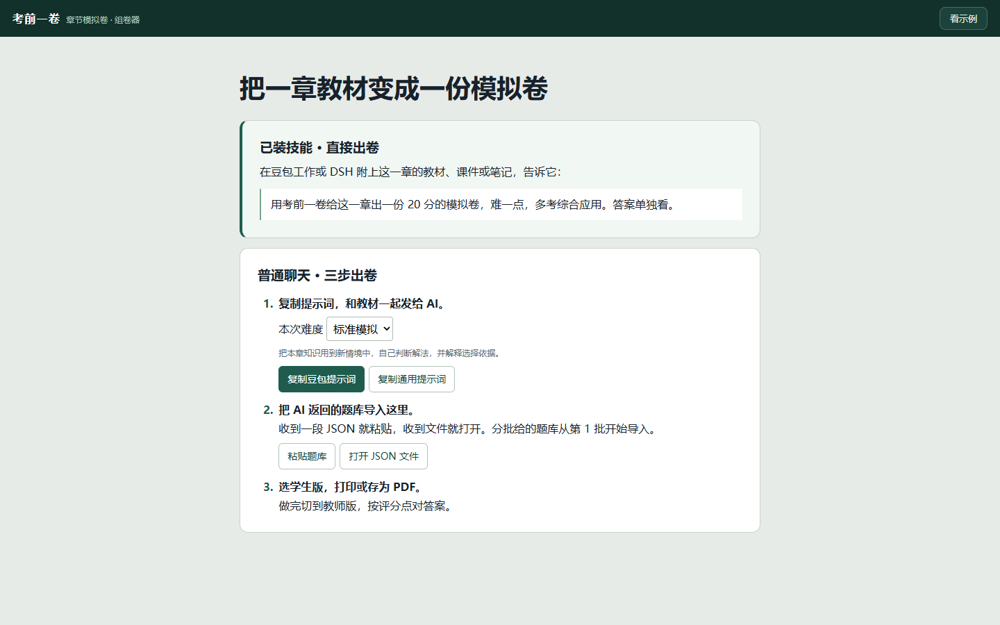
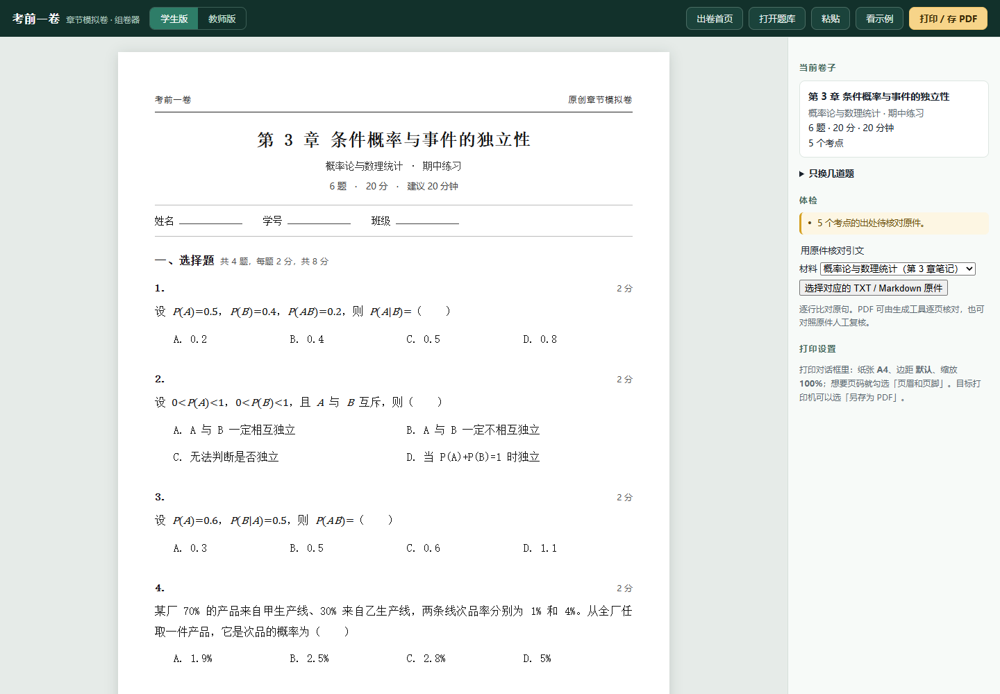
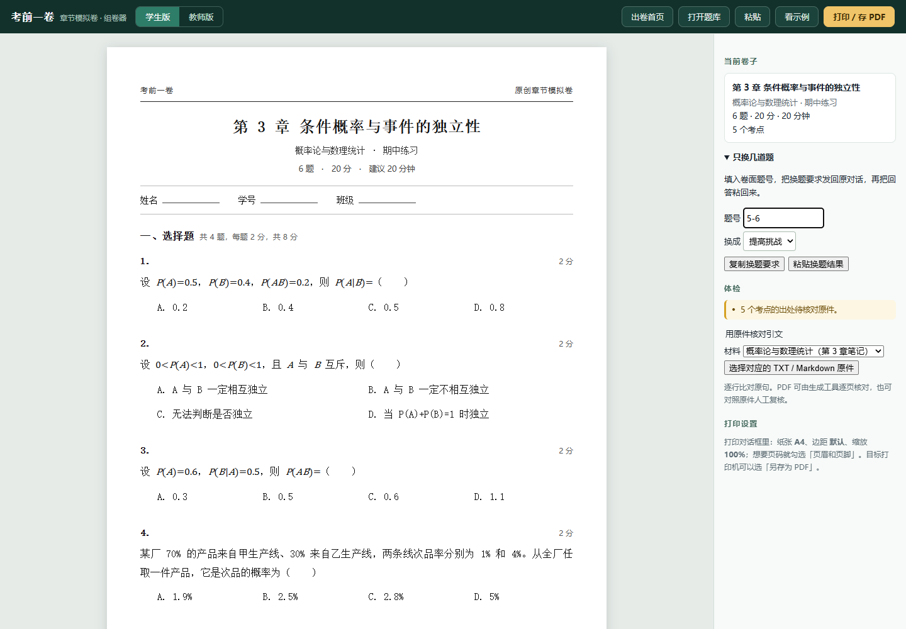
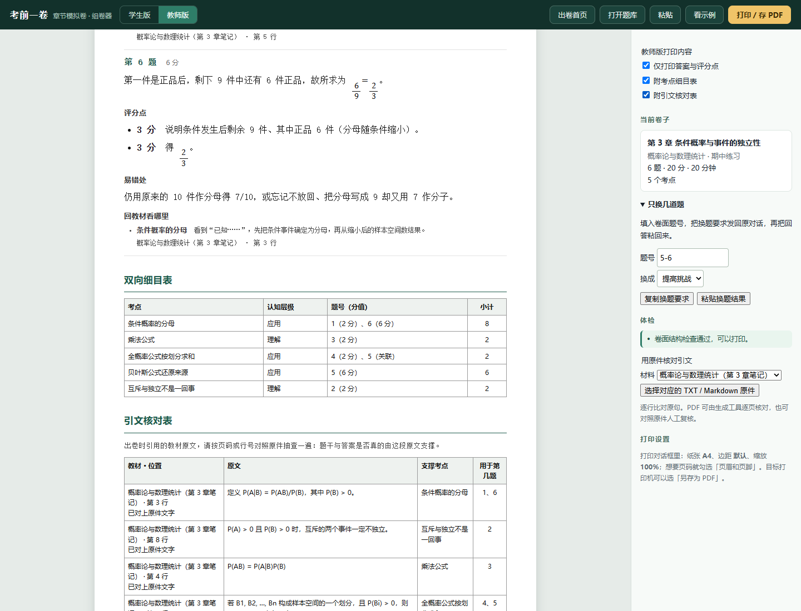

# 考前一卷 v1.2

> 把一章教材、课件或笔记，变成一份带评分标准、可直接 A4 打印的章节模拟卷。

[简体中文](./README.md) · [English](./README_EN.md)

[下载 v1.2](https://github.com/Damonhhh/chapter-exam/releases/tag/v1.2) · [先看学生卷 PDF](./概率论-最后两题提高.pdf)

**考前一卷** 是一套面向高校课程复习的 AI 组卷工具与技能包。把某一章的教材、PPT、笔记（以及可选的划重点或往年卷）发给 AI，即可生成排版规范的模拟卷：支持**学生版 / 教师版一键切换**、**三档难度调节**、**指定题号局部换题**、**公式渲染**、**试卷体检**与 **A4 打印 / 导出 PDF**。

---

## 核心特性

### 1. 三档难度可选（默认：标准模拟）

不指定难度时，默认按「标准模拟」直接出卷；也可按复习阶段随时切换：

| 难度档位 | 命题特点 | 适用场景 |
| :--- | :--- | :--- |
| **基础巩固** | 每题练一个知识点，给出直接条件，重点练定义、公式和典型步骤 | 刚学完本章，打牢基本功 |
| **标准模拟**（默认） | 把本章知识用到新情境中，自己判断解法，并解释选择依据 | 考前常规自测、期中/期末模拟 |
| **提高挑战** | 在本章范围内反推条件、比较方案或组合知识点，提高推理要求，保留合理计算量 | 冲刺高分、压轴题训练 |

- **豆包工作 / DSH 用户**：直接用自然语言说明要求即可（例如“出基础巩固卷”“难一点，多考反推条件”）。
- **普通聊天用户**：打开 [开始.html](./开始.html) 选好难度，一键复制对应提示词即可。

### 2. 支持局部换题（不用整卷重来）

做完觉得太简单或某几题不满意，可以**只替换指定题号**，其余题目、教材出处和整卷分值保持不变，同时自动同步更新对应答案与评分点。

> **概率论样卷实测示例**
>
> 指令：`前四题保留，把最后两题换成提高题。`
>
> - **保留内容**：前 4 题题干、教材出处、全卷 20 分总分结构完整保留。
> - **联动更新**：仅替换第 5、6 题及配套答案、评分点——第 5 题从“算出概率”升级为“反推次品率上限”，第 6 题要求解释“为什么两种展示规则会得到不同的概率”。

### 3. 学生版 / 教师版分离与 A4 打印

- **学生版**：纯净卷面排版，预留答题空间，直接打印或存为 PDF 模拟实考。
- **教师版**：查看参考答案与分步评分点；打印时可勾选「仅打印答案与评分点」，按需附加「考点细目表」与「引文核对表」。
- **内置体检与公式渲染**：单文件离线 HTML，无需安装环境，导入题库后自动检查题号、分值与批次完整性。

---

## 界面预览

| 出卷首页（选择难度 / 复制提示词） | 学生版 A4 排版预览 |
| :---: | :---: |
|  |  |

| 局部换题面板（指定题号升级难度） | 教师版答案、评分点与附表 |
| :---: | :---: |
|  |  |

---

## 成品样例（概率论）

以下 HTML 样卷下载后可在浏览器中打开，PDF 可直接在线预览。

- [原版样卷（可直接打印 HTML）](./样例-概率论-可直接打印.html)
- [只提高最后两题后的样卷（HTML）](./样例-概率论-只提高最后两题.html)
- [只提高最后两题的学生卷（PDF）](./概率论-最后两题提高.pdf)
- [配套答案与评分点（PDF）](./概率论-提高题答案.pdf)

---

## 快速开始

前往 [v1.2 下载页](https://github.com/Damonhhh/chapter-exam/releases/tag/v1.2) 下载 `chapter-exam-v1.2.zip`（或按需单独下载对应分包）并解压。

### 方式一：豆包工作（推荐，装一次即可直接出卷）

1. 打开豆包工作电脑版的 **「技能 · 连接器 · 伙伴」**。
2. 点击 **「新建 → 上传技能」**，直接上传 `chapter-exam-doubao-work-v1.2.zip`。
   - *注：若个人入口要求选择文件夹，将 ZIP 解压到名为 `chapter-exam` 的文件夹，选择打开后能直接看到 `SKILL.md` 的那一层即可。*
3. 新建对话，上传本章教材/课件/笔记，直接说：
   > 用考前一卷，按我给的这一章出一份 20 分的期中模拟卷。先给我能打印的卷子，答案单独看。

### 方式二：DSH（DeepSeek Harness）

1. 将 `chapter-exam-dsh-v1.2.zip` 解压到当前项目的 `.dsh/skills/` 目录（确保 `.dsh/skills/chapter-exam/` 下可直接看到 `SKILL.md`、`assets`、`references` 和 `scripts`）。
   - *若需跨项目通用，也可解压到个人目录 `~/.dsh/skills/`。*
2. 在该项目中开启新会话，选用 `chapter-exam` 或直接用中文呼叫“考前一卷”即可发教材出卷。

### 方式三：普通聊天用户（零安装，三步出卷）

无需安装任何插件，双击打开 [开始.html](./开始.html)（或直接向学生分发 `chapter-exam-student-v1.2.zip`）：

1. **选难度并复制提示词**：在首页选好难度档位，点击「复制豆包提示词」或「复制通用提示词」，连同本章 PDF、照片或笔记一起发给任意 AI。
2. **导入题库**：回到组卷器，收到 JSON 文本就点「粘贴题库」，收到文件就点「打开 JSON 文件」（分批返回时从第 1 批依次导入）。
3. **打印与对答案**：先在「学生版」打印或存为 PDF 做题，做完切到「教师版」按评分点核对。

---

## 局部换题操作指南

- **豆包工作 / DSH 用户**：在原对话中直接说明要保留和替换的题号即可，例如：`前四题保留，把最后两题换成提高题。`
- **普通聊天用户**：
  1. 在已载入试卷的右侧面板中，展开 **「只换几道题」**。
  2. 填入卷面题号（如 `5-6` 或 `2、5`）并选择目标难度。
  3. 点击 **「复制换题要求」** 发回原 AI 对话，再将 AI 返回的结果点击 **「粘贴换题结果」** 导入，原卷会自动局部更新。

---

## 发布包文件说明

| 文件名 | 说明 |
| :--- | :--- |
| `chapter-exam-v1.2.zip` | 含离线首页、HTML 样卷、三个分包和使用说明 |
| `chapter-exam-doubao-work-v1.2.zip` | 豆包工作专用技能包 |
| `chapter-exam-dsh-v1.2.zip` | DSH（DeepSeek Harness）专用技能包 |
| `chapter-exam-student-v1.2.zip` | 轻量分发包（含 `开始.html`、使用说明与样卷），适合直接发给普通聊天用户 |
| `开始.html` | 离线章节模拟卷组卷器（选难度、复制提示词、导入 JSON、体检、局部换题、A4 打印） |
| `使用方法.txt` | 本地简明使用说明 |
| `样例-概率论-*.html` / `概率论-*.pdf` | 概率论前后两份 HTML 样卷，以及提高卷和配套答案 PDF |

---

## 使用提示

- **独立测验 vs 自学**：独立测验请导出并分发**学生版 PDF**；HTML 文件自带教师版答案，更适合个人自学。
- **出处核对**：当没有教材原件可供核对时，卷面中的教材出处会自动标记为「待核对原件」。

---

## v1.2 验证状态

- **已验证**：三档难度提示词、指定题号局部换题、A4 打印与 PDF 导出；豆包工作与 DSH 两个技能包均已在本地解压并成功生成新版样卷。
- **待实测**：真实账号环境下的模型端到端出题效果尚未实测，欢迎在使用后通过 Issue 反馈体验与问题。
