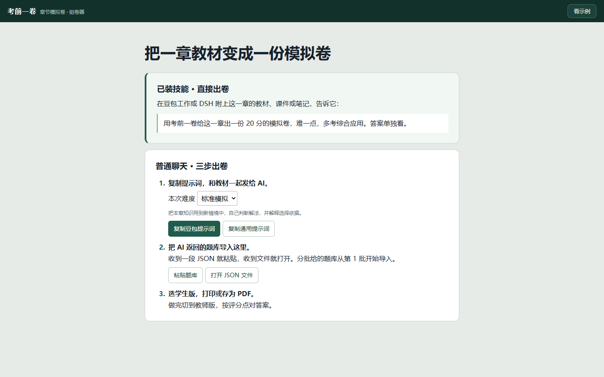
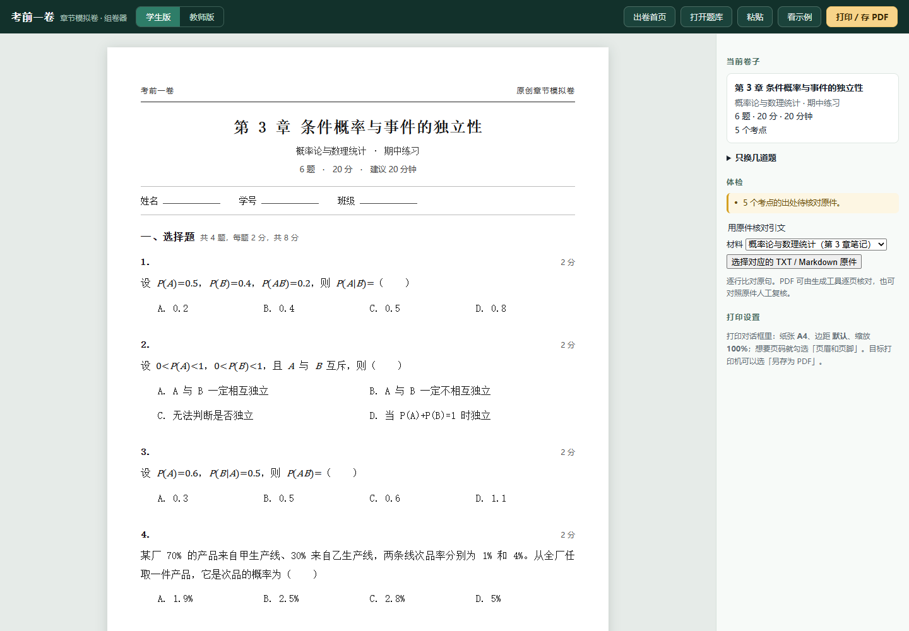
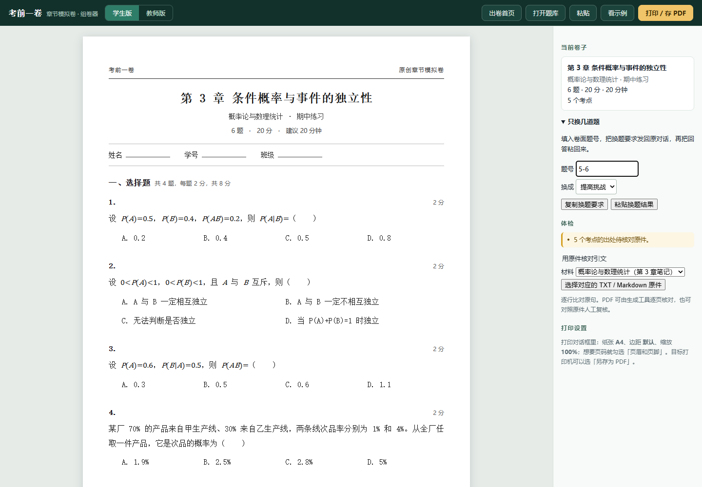
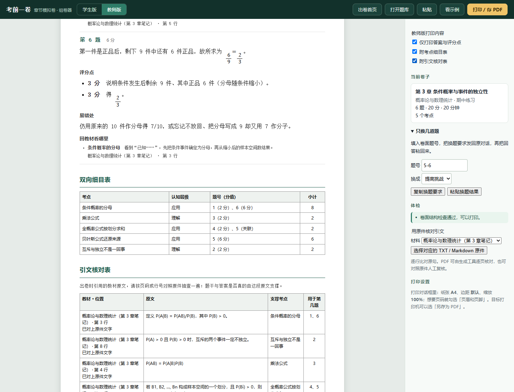

# Chapter Exam Generator (考前一卷) v1.2

> Turn a single textbook chapter, lecture slide deck, or set of notes into a printable A4 mock exam with step-by-step scoring rubrics.

[简体中文](./README.md) · [English](./README_EN.md)

[Download v1.2](https://github.com/Damonhhh/chapter-exam/releases/tag/v1.2) · [Preview the student exam (PDF)](./概率论-最后两题提高.pdf)

**Chapter Exam Generator (考前一卷)** is an AI-assisted exam builder and skill bundle designed for university course review. Feed an AI one chapter of your textbook, slides, or notes (plus optional exam outlines or past papers) to generate a print-ready mock exam featuring **one-click Student/Teacher view switching**, **three difficulty tiers**, **partial question replacement**, **built-in math rendering**, **paper validation checks**, and **A4 print / PDF export**.

---

## Key Features

### 1. Three Difficulty Tiers (Default: Standard Mock)

If no difficulty is specified, exams default to **Standard Mock (标准模拟)**. You can switch tiers at any time based on your study stage:

| Tier | Design Focus | Best For |
| :--- | :--- | :--- |
| **Foundations** (`基础巩固`) | One concept per question with direct conditions; focuses on definitions, formulas, and standard steps | Initial review right after finishing a chapter |
| **Standard Mock** (`标准模拟`, Default) | Applies chapter concepts to new scenarios; requires selecting the method and justifying choices | Routine self-testing, midterm/final prep |
| **Challenge** (`提高挑战`) | Reverse-engineering conditions, comparing approaches, or combining concepts within the chapter with reasonable calculation load | High-score sprint and capstone-style practice |

- **Doubao Work / DSH users**: State your preference in plain language (e.g., *"Make a Foundations exam"* or *"Make it harder with reverse-condition problems"*).
- **General chat users**: Open [`开始.html`](./开始.html), pick a difficulty tier, and copy the generated prompt.

### 2. Partial Question Replacement (No Full Regeneration Needed)

Finished an exam and found a few questions too easy? **Replace only specific question numbers** while keeping all other questions, textbook citations, and total points intact—along with automatic updates to the matching answer key and rubric.

> **Tested Example (Probability Theory Sample)**
>
> Prompt: *"Keep the first four questions, and replace the last two with Challenge-level questions."*
>
> - **Preserved**: Questions 1–4, textbook references, and the 20-point total structure remained untouched.
> - **Updated**: Questions 5–6 and their answer keys/rubrics were updated together—Q5 shifted from *"calculate the probability"* to *"derive the upper bound of the defect rate"*, and Q6 asked to explain *"why two display rules yield different probabilities"*.

### 3. Student / Teacher Modes & A4 Print Layout

- **Student Mode**: Clean exam layout with answer space, ready to print or save as PDF for timed practice.
- **Teacher Mode**: Full solutions and step-by-step scoring rubrics; optional checkboxes to print **Answers & Rubrics Only**, plus a **Topic Blueprint Table** and **Citation Verification Table**.
- **Built-in Math & Validation**: Single-file offline HTML with zero dependencies; automatically checks numbering, point totals, and batch completeness upon import.

---

## Screenshots

| Exam Builder Home (Difficulty & Prompt Copy) | Student Mode A4 Layout |
| :---: | :---: |
|  |  |

| Partial Replacement Panel | Teacher Mode Answers & Rubrics |
| :---: | :---: |
|  |  |

---

## Sample Outputs (Probability Theory)

Download the HTML samples and open them in a browser, or preview the PDFs on GitHub.

- [Original Printable Sample (HTML)](./样例-概率论-可直接打印.html)
- [Sample with Last 2 Questions Upgraded (HTML)](./样例-概率论-只提高最后两题.html)
- [Student Exam PDF — Last 2 Questions Upgraded](./概率论-最后两题提高.pdf)
- [Answer Key & Rubric PDF](./概率论-提高题答案.pdf)

---

## Quick Start

Download `chapter-exam-v1.2.zip` (or an individual package) from the [v1.2 release](https://github.com/Damonhhh/chapter-exam/releases/tag/v1.2) and unzip it.

### Option 1: Doubao Work (Install Once, Generate Anytime)

1. Open Doubao Work Desktop → **Skills · Connectors · Partners** (`技能 · 连接器 · 伙伴`).
2. Click **New → Upload Skill** (`新建 → 上传技能`) and upload `chapter-exam-doubao-work-v1.2.zip`.
   - *Note: If your workspace requires selecting a folder, unzip into a folder named `chapter-exam` and select the directory directly containing `SKILL.md`.*
3. Start a new chat, attach your chapter textbook/slides/notes, and ask:
   > Use Chapter Exam Generator (`考前一卷`) to create a 20-point midterm mock exam from this chapter. Give me the printable exam first, with answers separate.

### Option 2: DSH (DeepSeek Harness)

1. Unzip `chapter-exam-dsh-v1.2.zip` into `.dsh/skills/` in your project (so `.dsh/skills/chapter-exam/` directly contains `SKILL.md`, `assets`, `references`, and `scripts`).
   - *For global use across projects, unzip into `~/.dsh/skills/`.*
2. Start a new session in that project and invoke `chapter-exam` (or call it `考前一卷`).

### Option 3: General Chat Users (Zero Setup, 3 Steps)

Open [`开始.html`](./开始.html) directly in any browser (or distribute `chapter-exam-student-v1.2.zip` to students):

1. **Choose difficulty & copy prompt**: Select a difficulty tier, click **Copy Doubao Prompt** or **Copy Generic Prompt**, and send it along with your chapter PDF, photos, or notes to any AI.
2. **Import JSON**: Return to the builder and click **Paste Question Bank** (or **Open JSON File**; for multi-batch outputs, import starting from Batch 1).
3. **Print & grade**: Print or save **Student Mode** as PDF to take the test, then switch to **Teacher Mode** to grade with the rubric.

---

## How to Replace Specific Questions

- **Doubao Work / DSH users**: Simply reply in the same conversation, e.g., *"Keep questions 1–4 and replace the last two with Challenge-level questions."*
- **General chat users**:
  1. In the right-hand panel of a loaded exam, expand **Replace Selected Questions** (`只换几道题`).
  2. Enter question numbers (e.g., `5-6` or `2, 5`) and choose the target difficulty.
  3. Click **Copy Replacement Prompt** and send it back to your AI chat, then click **Paste Replacement Result** to update the exam in place.

---

## Release Package Contents

| File | Description |
| :--- | :--- |
| `chapter-exam-v1.2.zip` | Offline home page, printable HTML samples, all three packages, and a quick-start guide |
| `chapter-exam-doubao-work-v1.2.zip` | Skill package for Doubao Work |
| `chapter-exam-dsh-v1.2.zip` | Skill package for DSH (DeepSeek Harness) |
| `chapter-exam-student-v1.2.zip` | Lightweight student distribution bundle (`开始.html`, guide, and sample) |
| `开始.html` | Offline single-file exam builder (difficulty selector, prompt copier, JSON importer, validator, partial replacement, A4 print) |
| `使用方法.txt` | Quick local usage guide (Chinese) |
| `样例-概率论-*.html` / `概率论-*.pdf` | Original and revised HTML exams, plus PDFs of the revised exam and answer key |

---

## Notes

- **Independent testing vs. self-study**: Distribute the **Student Mode PDF** for closed-book quizzes. The HTML file embeds the Teacher Mode answers for convenient self-study.
- **Citation verification**: When no original textbook text is provided for verification, source citations are automatically labeled *"Pending source verification"* (`待核对原件`).

---

## v1.2 Verification Status

- **Verified**: Three-tier difficulty prompts, partial question replacement, and A4 print / PDF export. Both skill packages (Doubao Work and DSH) have been extracted locally and verified to generate updated sample exams.
- **Pending Live Testing**: End-to-end model generation quality under live user accounts has not yet been tested. Feedback and bug reports via Issues are welcome.
